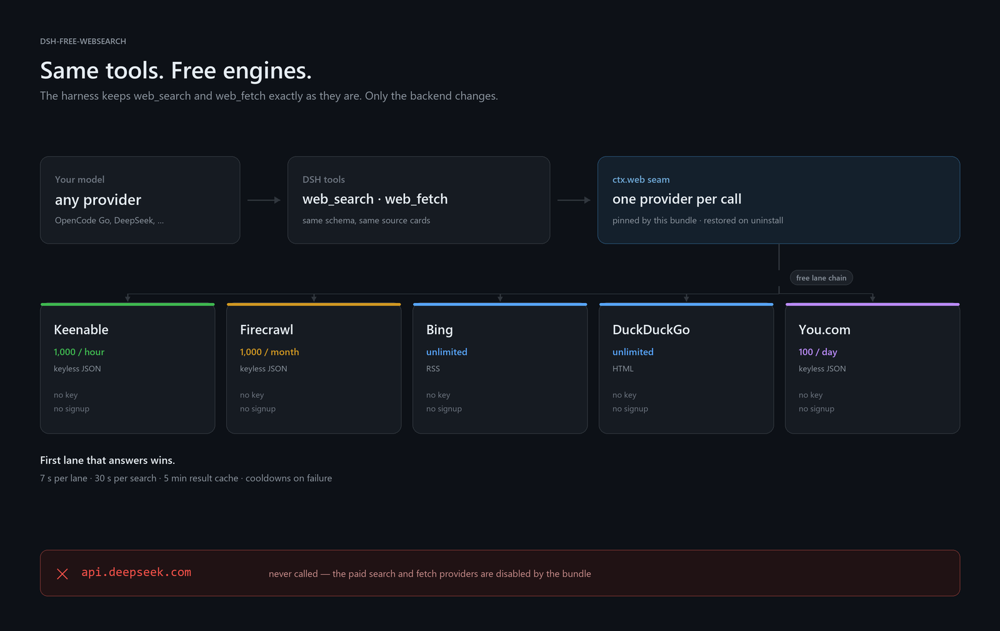
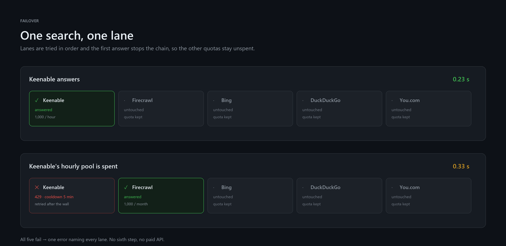
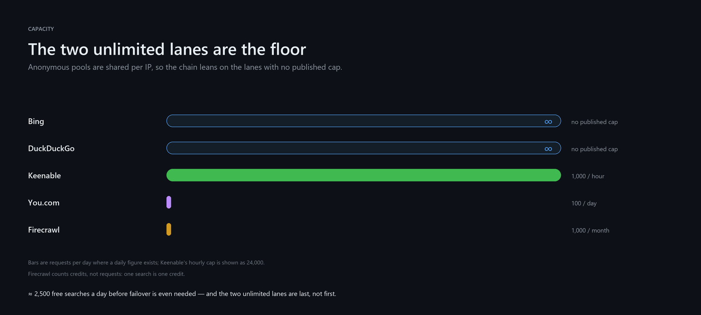
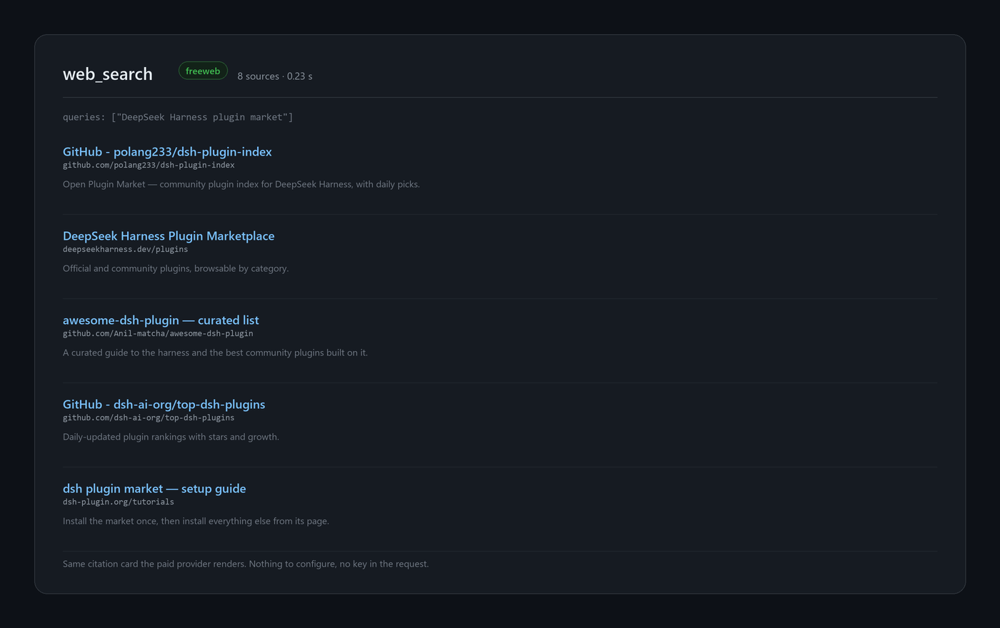

# dsh-free-websearch

[](https://www.npmjs.com/package/@jamolpe88/dsh-free-websearch)
[](https://www.npmjs.com/package/@jamolpe88/dsh-free-websearch)
[](https://github.com/JaMoLpE88/dsh-free-websearch/releases)
[](LICENSE)
[](#compatibility)
[](#compatibility)
[](#why-there-is-no-settings)
[](https://dsh-plugin.org/plugins/jamolpe88/dsh-free-websearch)

**Free web search and page fetch for the DeepSeek Harness.** Five keyless engines sit behind the harness's own `web_search` and `web_fetch`, with automatic failover, and the paid DeepSeek search and fetch providers are switched off. Install it and the DeepSeek platform is out of the loop — whatever model you are running.

Zero configuration. No signup, no API key, no settings page, no paid fallback: if every free lane is down the search fails with a report instead of spending a credit.

**Español** → [README.es.md](README.es.md)



*The tools do not change. The `ctx.web` seam picks a provider per call, this bundle pins its own, and five keyless lanes answer behind it. The DeepSeek search and fetch providers are disabled by the same patch, so there is no path back to the paid API by accident.*



*One search, one lane. The first answer stops the chain, so the other quotas stay unspent; a walled lane cools down and the next one takes over.*



*Two lanes have no published cap, which is why they are the floor of the chain rather than the head. The anonymous pools are shared per IP, so the unlimited ones catch a busy network.*



*The same citation card the paid provider renders: titles, URLs and snippets, produced without an API key.*

## What it does

- Serves the harness's **`web_search`** through five free engines: Keenable, Firecrawl keyless, Bing, DuckDuckGo and You.com.
- Serves **`web_fetch`** locally first (the harness's own HTTP provider) and escalates to Firecrawl's keyless scrape only when the page is a wall, empty, or a JavaScript shell.
- **Disables DeepSeek's paid search and fetch providers** (`deepseek-official`, `deepseek-search-api`, `deepseek-fetch-api`), so no setting, fallback chain or UI switch can reach them.
- Fails over in order and stops at the first lane that answers: one search spends one lane's quota, not five.
- Caches results for **5 minutes** (50 entries), so a repeated question costs nothing.
- Cools a lane down after a wall (5 min) or a spent monthly pool (for the rest of the process) instead of hammering it.
- Names every lane it tried when it gives up, and says that nothing was sent to a paid API.
- Restores the shipped DeepSeek behaviour when the bundle is disabled or removed.

## What it does not do

- It does not add tools. No `x_search`, no `read_page`, no `multi_search`, no research pipeline.
- It does not read credentials. Not DeepSeek's, not anyone's: the plugin never imports the credential service, so it cannot spend a key that is stored.
- It does not call `api.deepseek.com` under any circumstance.
- It does not scrape cookies, keep history, or send telemetry.
- It does not render JavaScript locally. It escalates instead, and only for public targets.

## Why there is no settings

There is nothing to decide. The lane order is the same for everyone, every lane is keyless, and the quotas are anonymous. A settings page would only ask you to pick a lane whose quota you cannot see and whose failure the chain already handles.

The one knob that matters — "may this cost me money?" — is not a preference. It is answered by the bundle patch: the paid providers are disabled, so the answer is no.

## What it replaces

| Paid route in the harness | Provider id | How it ends up |
|---|---|---|
| Search through Messages (`web_search_20250305`) | `deepseek-official` | Disabled. `web_search` runs the free chain |
| Search API (`/v1/tools/search`) | `deepseek-search-api` | Disabled, same replacement |
| Fetch API (`/v1/tools/fetch`) | `deepseek-fetch-api` | Disabled. `web_fetch` runs local → keyless scrape |
| Local fetch | `http` | Kept, and delegated to rather than reimplemented |

Everything else the harness does — session titles, compaction, subagents, workflows — runs through **your model**, not through a DeepSeek endpoint. There is no third place to fix.

## The five lanes

Tried in this order. A lane is skipped while it is cooling down.

| Lane | Endpoint | Anonymous quota | Role |
|---|---|---|---|
| `keenable` | `api.keenable.ai/v1/search/public` | 1,000 requests/hour per IP | Absorbs most traffic: JSON, ~0.4 s |
| `firecrawl` | `api.firecrawl.dev/v2/search` | 1,000 credits/month | Best snippets; scarce, so second |
| `bing` | `www.bing.com/search?format=rss` | No published cap | The floor, ~0.3 s, direct URLs |
| `ddg` | `html.duckduckgo.com/html/` | No published cap | The other floor |
| `you` | `api.you.com/v1/agents/search` | 100 searches/day per IP | Last resort |

Budgets: **7 s per lane**, **30 s per search**, five-lane chain, 5-minute result cache. No retries inside a lane: a failure moves on immediately, which is cheaper than waiting for a server that already said no.

## Requirements

- **DSH Desktop** `>= 0.2.1-rc.3`, profile `desktop` (tested on `0.2.1-rc.3`, Windows 11).
- Outbound HTTPS. That is all.
- Node 22+ (DSH ships its own runtime; the package itself only needs 20.3).

No DeepSeek API key. No provider configured. No account.

## Install

From the desktop app: **Plugins → Add plugin**, then `@jamolpe88/dsh-free-websearch`.

From npm:

```bash
dsh plugin --profile desktop add @jamolpe88/dsh-free-websearch
```

The `web` profile takes the same package:

```bash
dsh plugin --profile web add @jamolpe88/dsh-free-websearch
```

From the repository:

```bash
dsh plugin --profile desktop add github:JaMoLpE88/dsh-free-websearch
```

From a local checkout, while developing:

```bash
dsh plugin --profile desktop add link:C:\path\to\dsh-free-websearch
```

Refresh the DSH window. In a live profile the bundle applies without a restart; the Plugins page lists **Free Web Search** and the official **Web search** card stops appearing, because its two providers are no longer mounted.

## Usage

1. Ask anything that needs the web, as usual. The model calls `web_search`; sources come back with a citation card.
2. Paste a link or ask about a page. `web_fetch` reads it locally and escalates only if the page needs a browser.
3. Nothing else. There is no command, no pill, no panel.

If a search fails, the error names the lanes that were tried and why, for example `keenable: HTTP 429; bing: no results`. Retry, or check whether a VPN is rewriting your egress IP.

## How it works

The plugin registers two providers into the harness's existing seam, then the bundle patch selects them:

```js
ctx.web.registerSearchProvider({ id: 'freeweb', available: () => true, search })
ctx.web.registerFetchProvider({ id: 'freeweb-fetch', available: () => true, fetch })
```

```yaml
- id: web
  config:
    searchProvider: freeweb
    fetchProvider: freeweb-fetch
- id: web-search-deepseek
  disabled: true
- id: web-deepseek-api
  disabled: true
```

- **Selection is pinned declaratively.** A patch row replaces the targeted row's whole config, so both seam keys are restated. Uninstalling the bundle removes the pin and the disables together; the harness returns to `deepseek-official` / `http`.
- **A runtime fallback covers manual installs.** If the bundle patch did not land (a plain dependency, or an older profile), the plugin writes the same selection through `settings.mutate` once the settings service is mounted, and only when the current value is the shipped default. It never overrides a deliberate choice, and it writes the shipped ids back when it unloads.
- **`available()` is cheap and offline.** The honest verdict belongs to execution, whose error carries every attempt; answering `false` up front would turn a transient network problem into a seam-misconfiguration error.
- **The fetch chain reuses the harness.** `freeweb-fetch` delegates to the registered `http` provider first, so URL validation, address pinning, redirect rules and HTML→markdown conversion stay the harness's. Only when that result is a wall, empty, or a JavaScript shell does the plugin call Firecrawl's keyless scrape.
- **Disclosure is checked before it happens.** The target's every resolved address must be public before the URL is sent to Firecrawl. `localhost`, private ranges, CGNAT and link-local addresses never leave the machine, and an unresolvable host is not disclosed either.

## Verifying it

```bash
npm test        # 16 tests: parsers, failover, cooldown, cache, SSRF guard, takeover
npm run probe   # live check of the five endpoints and the fetch escalation
```

The probe prints each lane's HTTP status, runs real searches through the chain with their latency and sources, and proves that a blocked private target is never escalated. It uses the network; the tests do not.

## Uninstall and revert

Remove the bundle (Plugins → Remove, or `dsh plugin --profile desktop remove @jamolpe88/dsh-free-websearch`). The patch layer disappears with it:

- `web` returns to the shipped `searchProvider: deepseek-official` / `fetchProvider: http`,
- both DeepSeek providers re-enable,
- no plugin files, no settings of its own, no state left behind.

Disabling the bundle has the same effect. If it was installed as a plain dependency, the plugin also writes the shipped ids back when it unloads.

## Compatibility

| | |
|---|---|
| DSH | `>= 0.2.1-rc.3` (the only version tested by the author) |
| Node | `>= 20.3` (the package); DSH ships 22+ |
| OS | Windows 11 (tested); the code is plain Node, macOS and Linux untested |
| Profile | `desktop` (tested); `web` boots and searches through the same seam |
| Seam | `ctx.web` search + fetch providers |
| Catalog | [listed on dsh-plugin.org](https://dsh-plugin.org/plugins/jamolpe88/dsh-free-websearch) |

Validation status: **tested on Windows 11 with DSH Desktop 0.2.1-rc.3** (2026-10-28). The bundle applied live, both paid providers left the composition, `web_search` returned eight cited sources from the free chain, `web_fetch` returned page text, and a blocked private target was refused without a cloud request.

Not validated: macOS, Linux, other DSH versions, and the `web` profile.

## Limits

- **The lanes are third-party goodwill.** Anonymous quotas can change, shrink or start asking for a CAPTCHA without notice. That is why there are five and why the chain fails over.
- **A VPN can break the keyless tiers.** Firecrawl gates its anonymous tier by egress IP and may answer 403; Keenable and Bing keep the search working.
- **Bing occasionally serves an empty SERP to data-centre or proxy IPs.** DuckDuckGo is the second unlimited lane for that case.
- **No X/Twitter search.** There is no free path that does not require a paid account, so the plugin does not pretend otherwise.
- **No JavaScript rendering of its own.** Escalation to a cloud scraper is the only browser-like path, and only for public pages.
- **Anonymous pools are shared per IP.** A busy office network sees the keyless ceilings sooner than a home connection.

## Privacy

- The query goes to the lane that answers, and to each lane tried before it. Nothing else is sent.
- A page URL leaves the machine only through `web_fetch`'s escalation, only after every resolved address is proven public.
- No cookies, no key, no account, no local storage, no telemetry.
- The plugin never reads the credential store, so no API key can leak through it.

See [SECURITY.md](SECURITY.md) for the short policy.

## Troubleshooting

**Searches fail with "every free search lane failed".**
The message lists each lane and its error. `HTTP 429` on keenable means the shared hourly pool is spent; `bot wall` on ddg means it wants a CAPTCHA. Retry after a few minutes, or disable the VPN.

**`web_fetch` returns a page with very little text.**
The local fetch worked but the site renders with JavaScript and the escalation found nothing better. Nothing is wrong: that is what the site serves.

**The official "Web search" card disappeared from Plugins.**
Expected: it exists only while `web-search-deepseek` serves its namespace, and this bundle disables it. Uninstall the bundle to bring it back.

**A page is refused as a private target.**
The escalation guard declined to send it to the cloud. Local fetch still worked; only the cloud path is blocked.

## Development

```bash
npm test        # node --test
npm run probe   # live lane check
python tools/make-assets.py   # regenerate the artwork in assets/
```

The package is plain JavaScript with no build step and no runtime dependencies. The tests stub `fetch`, so they run offline and never touch a real endpoint.

## Third-party marks

DeepSeek, Bing, DuckDuckGo, Firecrawl, Keenable and You.com are trademarks of their respective owners. They are named only to describe which service a lane talks to; no logo is bundled and no affiliation is implied.

## License

[MIT](LICENSE) © 2026 JaMoLpE88
